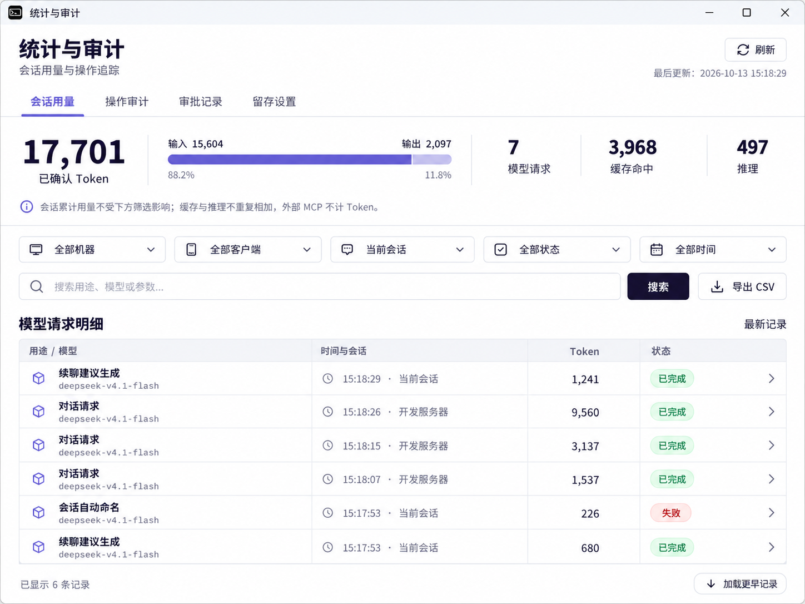
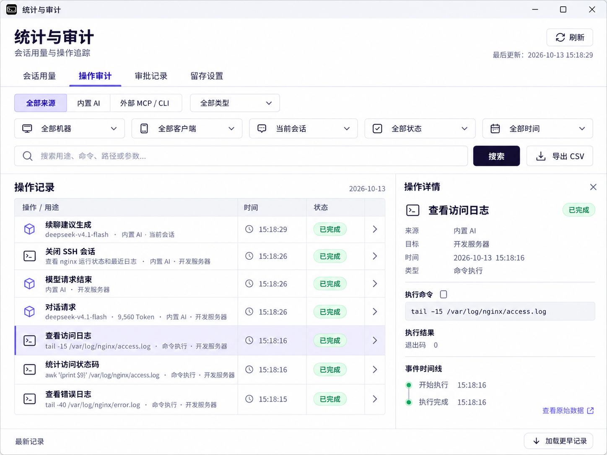

# 统计与审计视觉重设计候选

> 状态：Approved
> 最后更新：2026-10-13
> 关联：[现有批准设计](ai-usage-and-audit.md)、[实现契约](../03-architecture/ai-usage-and-audit.md)、[文档索引](../README.md)

## 范围与依据

用户首先要求根据三张现有截图重新生图设计，使用内置 image_gen 工具生成会话用量、操作审计和审批空状态三张视觉候选；随后于 2026-10-13 确认“就按照这些方式来，统一全部处理下”，批准按这一方向统一统计与审计窗口，包括留存设置与操作详情。实现与运行验证分别记录在[质量记录](../04-quality/ai-usage-and-audit.md#2026-10-13-统一审计窗口视觉)。

已确认：项目使用 awesome-design-md，来源 VoltAgent/awesome-design-md，Style ID 为 sentry；四个现有页签及筛选、搜索、导出、查看记录等功能来自当前界面。用量统计语义继续遵循现有批准设计。

已批准的视觉方向：统一信息层级、8px 间距节奏和平面分区，将用量改为数字概览、记录按列对齐，并加入右侧详情栏、重置明细筛选和空页导出禁用状态。图片使用浅色、深墨色文字和紫色强调；原生实现使用项目现有主题 token，适配浅色与深色模式，不固定图片中的背景和主题色。命令摘要仅使用已记录用途，不额外调用模型或猜测用途；SSH 控制、文件操作等保留实际动作名称。

图中数字、命令及返回状态用于排版示例，不作为运行验证证据；机器名称采用通用占位名称。设计图拟采用约 1200×900 的 4:3 比例，实际输出为生图工具决定的像素尺寸。

## 候选图

### 会话用量



### 操作审计



### 审批记录空状态


## 检查范围

已查看三张生成结果，核对页签、主要文案、用量语义、记录层级和空状态含义；复制后的三个 PNG 与原始输出的 SHA-256 一致。

生图阶段未修改界面代码。后续确认实施阶段已写入原生视图；本地仅执行格式与静态检查，未编译、运行 Rust 测试或启动应用。仍需验证默认 1040×760 客户区、760×600 窄窗口、深色主题、英文文案及键盘状态，不能直接把生图比例当作原生布局验收结果。

## 原生实现约束

- 四个页签统一采用下划线导航、紧凑筛选与搜索、语义状态徽标及页面记录数。
- 用量只复用已有汇总；比例条来自已报告输入、输出分项，零分项时使用空轨道。缓存和推理不额外加入总量；等待与未知请求继续明确展示。
- 宽度达到约 1000px、且字体缩放允许时，列表与详情并排；较窄窗口或较大字体使用完整详情页。用量列表在并排详情时将时间、目标放到详情区，保留用途、Token 与状态的可读性。
- 重置明细筛选清除机器、客户端、分类、来源、状态、时间、搜索及分页游标，保留当前会话归属；用量页强制模型来源的条件只作用于查询，不覆盖其他页签的来源选择。
- 详情时间线默认折叠参数与原始 JSON，仍可逐条展开、复制、查看关联操作与加载更早事件。正文导出继续使用统一确认框。
- 留存设置按留存策略、脱敏规则、独立清理分区；保存按钮置于固定底栏。现有留存、删除、脱敏与加密规则不变。

## 实际生图提示词

### 会话用量

参考输入：用户的第一张截图。

```text
Use case: ui-mockup.
Asset type: high-fidelity redesign concept, screenshot of the Windows native Rust/GPUI desktop application TinyShell, Statistics and Audit utility window.
Primary request: Thoroughly redesign the attached ugly session usage screen into an elegant, precise, implementable Chinese desktop developer tool UI. The attached image is an EDIT TARGET and a functional-content reference: replace its visual layout and typography while retaining its existing purpose and four navigation tabs. Render ONE complete window filling the image, at about 1200x900 landscape 4:3, front facing, crisp readable Chinese text, no perspective, no background scenery, no additional windows.
Design system: local awesome-design-md Sentry adaptation for functional desktop surfaces. White #ffffff main canvas; ink #1f1633; dark primary #150f23; violet #6a5fc1 used sparingly for active tab and small usage visual elements; border #e5e7eb; soft cool lavender selected/hover tint; 8px spacing rhythm; compact controls 32px high, 6px corners; thin flat dividers, no nested cards. Chinese system sans similar Microsoft YaHei / Noto Sans SC, code and numeric values in tabular monospace. Page heading 22px, labels 13-14px, metadata readable 12px. Existing semantic success green and error muted red are allowed only for states, never large backgrounds. Design should feel like a polished native technical console, richly composed but restrained.
Composition: retain a subtle 30px Windows titlebar with a small terminal mark, title “统计与审计”, and window controls. Below it a properly spaced header title “统计与审计” with subtitle “会话用量与操作追踪”, outline refresh control on right. Under header: slim horizontal navigation tabs “会话用量” ACTIVE with violet underline, “操作审计”, “审批记录”, “留存设置”; no pill-button navigation.
Session summary: one cohesive flat metric band, no separate floating cards. Largest left number “17,701” with caption “已确认 Token”, beside it a slim proportional violet input/output bar labeled “输入 15,604” / “输出 2,097”. Two smaller separated metrics “7” “模型请求”, “3,968” “缓存命中”; small secondary text “推理 497”. Preserve correct meaning: cache and reasoning counts are components, not additional tokens; filters apply only to audit details and must not visually imply summary recalculation. Beneath band a discreet info icon and sentence “会话累计用量不受下方筛选影响；缓存与推理不重复相加，外部 MCP 不计 Token。” No invented chart, time history or cost/billing.
Filters: meaningful consistent toolbar with labeled compact dropdowns “全部机器”, “全部客户端”, “当前会话”, “全部状态”, “全部时间”. Second toolbar: search input with search icon and placeholder “搜索用途、模型或参数…”; compact “搜索” primary dark button; trailing outlined download button “导出 CSV”. Align everything cleanly in 24px gutters.
Records: section title “模型请求明细” and small right label “最新记录”. Refined full-width table with light header, columns “用途 / 模型”, “时间与会话”, “Token”, “状态”. Six visible rows with gentle 1px separators, right aligned token numbers, compact colored outline status badges and a far-right chevron. Purpose on main line semibold, model second line muted monospace. Representative rows: “续聊建议生成” / “deepseek-v4.1-flash” / “15:18:29 · 当前会话” / “1,241” / “已完成”; “对话请求” / same model / “15:18:26 · 开发服务器” / “9,560” / “已完成”; next token “3,137”; next token “1,537”; “会话自动命名” / same model / “15:17:53 · 当前会话” / “226” / “失败”; last “续聊建议生成” / “15:17:53” / “680” / “已完成”. Include understated model/source icon, not large decorative square blocks. No raw real hostnames or IP addresses from reference; use safe synthetic “开发服务器” and “当前会话”. The table must keep a compact high information density with a balanced amount of breathing room, not airy marketing cards.
Bottom fixed narrow footer: left “已显示 6 条记录”, right clear “加载更早记录” button.
Constraints: polished pixel-level alignment; coherent functional hierarchy; only this one session-usage screen; no invented sidebar, no revenue chart, no decorative gradient, no glassmorphism, no mascots, no giant cards or round blobs, no slogans or design annotations outside the UI. Do not preserve the original browser-like cramped buttons or giant undifferentiated whitespace.
```

### 操作审计

参考输入：用户的第二张截图；会话用量候选图用于统一视觉。

```text
Use case: ui-mockup.
Asset type: second screen in a coherent redesign of TinyShell native Windows Statistics and Audit desktop window.
Input images: IMAGE 1 is the EDIT TARGET, the old operations-audit screenshot, used for existing navigation, filters and event types. IMAGE 2 is the APPROVED-FOR-THIS-IMAGE style reference from the first generated usage concept, used to match exact visual language and window proportions; do not reuse its token summary because this is the operations tab. No human approval is implied by this descriptive style-role label.
Primary request: Create ONE complete redesigned Chinese “操作审计” screen, 1200x900 landscape 4:3, polished pixel-perfect front facing native UI screenshot, occupying the whole image, no outside presentation board. Match the style reference's chrome, heading, navigation, controls and typography, but with an elegant compact two-pane master-detail operations view.
Visual system: white functional canvas, #1f1633 dark ink, #150f23 primary search button, #6a5fc1 violet active tab and tiny icons, subtle lavender selection tint, #e5e7eb dividers, consistent 8px grid, 24px content gutters, controls 32px high and 6px corner radius. System Chinese sans, monospace for commands. Green outline “已完成” status, subtle red “失败” status only for semantic states. No gradients or oversized cards. Native desktop developer-tool information density.
Top: Windows titlebar with terminal mark “统计与审计” and controls. Same header “统计与审计”, smaller “会话用量与操作追踪”, outlined “刷新” action on right. Same slim underline navigation “会话用量”, “操作审计” ACTIVE, “审批记录”, “留存设置”. Header should stay compact and leave ample area for working data.
Toolbars: first row a proper source segmented control “全部来源” SELECTED, “内置 AI”, “外部 MCP / CLI”, followed by dropdown “全部类型”. Next row five consistently sized icon dropdowns “全部机器”, “全部客户端”, “当前会话”, “全部状态”, “全部时间”. Third row search input “搜索用途、命令、路径或参数…” plus dark “搜索” button and outlined download “导出 CSV”. Keep vertical spacing deliberate and tight.
Content heading “操作记录” with subdued right text “2026-10-13”. Main working area split roughly 66% left table and 34% right inspector, single shared vertical separator. Both are flat open surfaces, not cards nested in cards. Table columns “操作 / 用途”, “时间”, “状态”, narrow chevron. Seven rows; easy to scan titles, a smaller muted target/source metadata line and technical second line:
1 “续聊建议生成” with model “deepseek-v4.1-flash”, metadata “内置 AI · 当前会话”, time “15:18:29”, green “已完成”.
2 “关闭 SSH 会话”, purpose “查看 nginx 运行状态和最近日志”, metadata “内置 AI · 开发服务器”, time “15:18:26”, “已完成”.
3 “模型请求结束”, metadata “内置 AI · 开发服务器”, time “15:18:26”, “已完成”.
4 “对话请求”, model “deepseek-v4.1-flash · 9,560 Token”, time “15:18:26”, “已完成”.
5 “查看访问日志” (SELECTED with thin violet left edge and pale lavender row fill), monospace “tail -15 /var/log/nginx/access.log” clipped with ellipsis if necessary, metadata “命令执行 · 开发服务器”, time “15:18:16”, “已完成”.
6 “统计访问状态码”, mono “awk … /var/log/nginx/access.log”, time “15:18:16”, “已完成”.
7 “查看错误日志”, mono “tail -40 /var/log/nginx/error.log”, time “15:18:15”, “已完成”.
Use distinct tiny stroke icons for model, SSH and command event, no colored icon blocks. Purpose summaries intentionally make commands comprehensible; commands remain visible separately in monospace. Avoid printing long shell scripts as row titles. Never include original real server IP; only synthetic “开发服务器”.
Right inspector: modest header “操作详情” and close icon, title “查看访问日志”, outlined green “已完成” badge. Metadata key-value rows “来源” “内置 AI”; “目标” “开发服务器”; “时间” “2026-10-13 15:18:16”; “类型” “命令执行”. Divider. Small section label “执行命令” with a copy icon; a tidy pale neutral code area containing “tail -15 /var/log/nginx/access.log”, wrap at sensible command boundaries, dark ink monospace no saturated code background. Small section “执行结果” with “退出码 0”. Another divider and “事件时间线” with two subtle vertically connected nodes “开始执行 15:18:16” and “执行完成 15:18:16”; small bottom text link “查看原始数据”.
Bottom narrow fixed footer, left “最新记录”, right outlined “加载更早记录”.
Constraints: exact family resemblance to style reference; excellent legible simplified Chinese; flat organized layout, aligned metadata, slim horizontal row separators; one complete functional screen only, no token metric strip on this screen, no invented sidebar, no fake monitoring graph, no decorative illustrations, no glossy effects, no huge gaps, no design annotations, no business billing information.
```

### 审批记录空状态

参考输入：用户的第三张截图；会话用量候选图用于统一视觉。

```text
Use case: ui-mockup.
Asset type: third screen in a coherent redesign of TinyShell native Windows Statistics and Audit desktop window.
Input images: IMAGE 1 is the EDIT TARGET, the old approvals empty-state screenshot, a reference for existing filters and navigation. IMAGE 2 is a style reference only, the newly generated usage concept. Preserve the family resemblance while redesigning the approvals screen.
Primary request: Render ONE complete high-fidelity Chinese desktop application screenshot of “审批记录” in an empty state, landscape 4:3 about 1200x900. Front-facing, fills entire frame, no surrounding scenery, no multiple windows. Beautiful restrained functional UI, noticeably designed rather than a blank white screen.
Design system: same exact white #ffffff canvas, #1f1633 deep ink, #150f23 dark primary action, #6a5fc1 active tab and subtle illustration linework, #e5e7eb fine dividers, pale cool lavender controls. 8px spacing grid, 24px outer gutters, compact 32px controls with 6px radius, strong legible simplified Chinese sans. No marketing decoration.
Window and header: retain Windows native titlebar with small terminal mark, “统计与审计” and three window controls. Below: same compact heading “统计与审计” and subtitle “会话用量与操作追踪”, refresh outline button “刷新” at right with small secondary “最后更新：2026-10-13 15:18:29”. Same slim horizontal nav: “会话用量”, “操作审计”, “审批记录” ACTIVE violet underline, “留存设置”. Same placement and scale as style reference.
Filter area: first toolbar source segmented tabs “全部来源” selected, “内置 AI”, “外部 MCP / CLI”, and dropdown “全部类型”. Second toolbar five consistently aligned icon dropdowns “全部机器”, “全部客户端”, “当前会话”, “全部状态”, “全部时间”. Third toolbar long search input “搜索用途、命令、路径或参数…”, dark “搜索” button, download “导出 CSV” visibly disabled in a subtle low-contrast light-gray treatment, not primary. Maintain consistent hierarchy; separate filter area and data area with a thin divider.
Data area: upper-left modest title “审批记录” with adjacent small subdued “0 条”; right small “当前筛选范围”. No table rows or artificial records, no model usage summary.
Empty state centered within the remaining working area, slightly above its geometric center. Use one small (around 90x70px at base scale) carefully drawn abstract outline document with a checkmark / shield and a tiny search lens, lavender thin strokes and a tiny deep-violet accent; no large icon tile, no enclosing circle, no cartoon mascot, no 3D. Below, clear compact title “当前筛选下暂无审批记录”. Muted two-line explanation, exact: “需要人工确认的请求会在此留下记录。” and “尝试调整时间范围，或清除当前筛选。” Two aligned compact buttons below with 12px gap, “重置筛选” primary dark, “刷新记录” outlined. The illustration, heading, text, and buttons form a cohesive block, with thoughtful whitespace above and below, not a giant hero. Keep block small enough to respect desktop information density.
Below block, a separated low-emphasis inline info note with a small info icon: “审批记录可用于查看审批决定及其关联操作。” This is an informative empty-state cue, not a new policy. Never imply that no records means no approval is required or all requests are automatically approved.
Bottom fixed narrow footer above a hairline: left “已显示 0 条记录”, right disabled outlined “加载更早记录”. All top controls remain available and legible.
Constraints: excellent alignment and consistent Chinese font, flat desktop surface, clear affordances, compact high-quality utility window; one complete screen only, no invented sidebar, no approvals statistics or charts, no billing, no gradients, no giant cards, no oversize colorful icon blocks, no decorative wallpaper or real hostnames/IPs, no mockup captions outside the UI. The empty-state message must be semantically precise: absence under current filters, not necessarily absence of all historical records.
```

